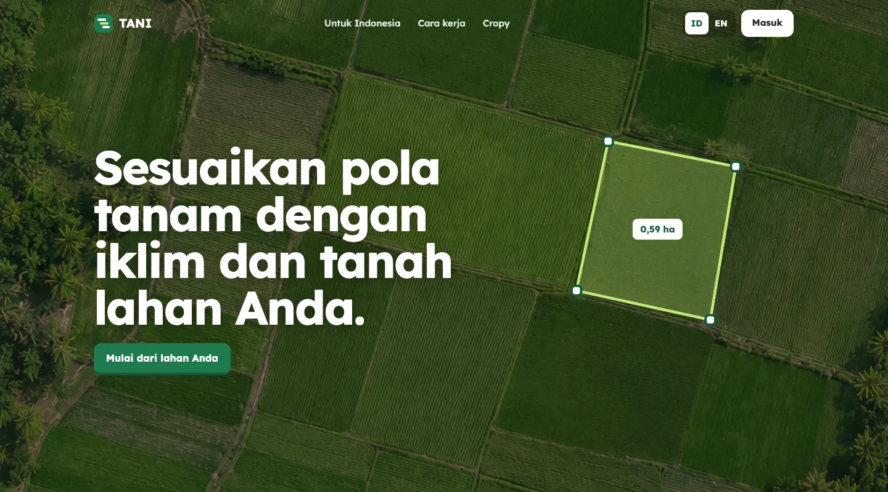
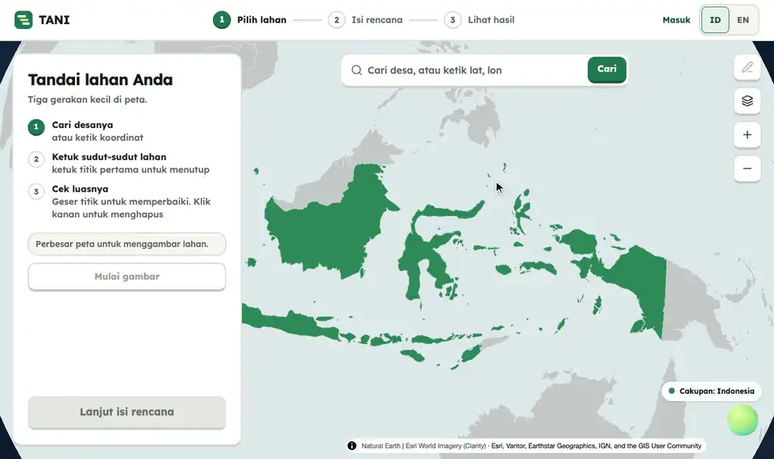
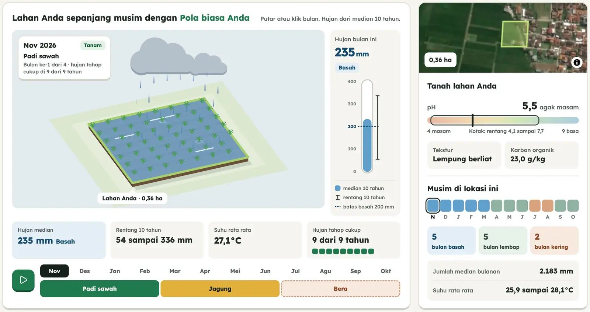
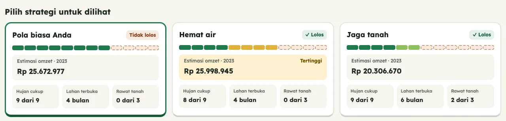
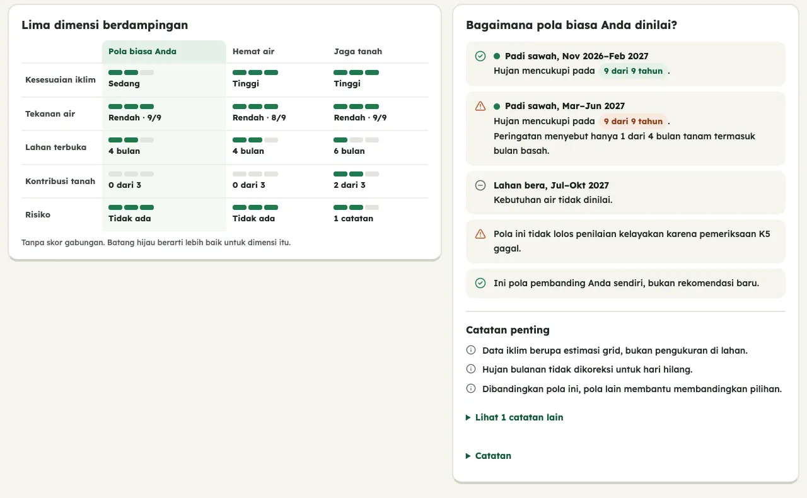
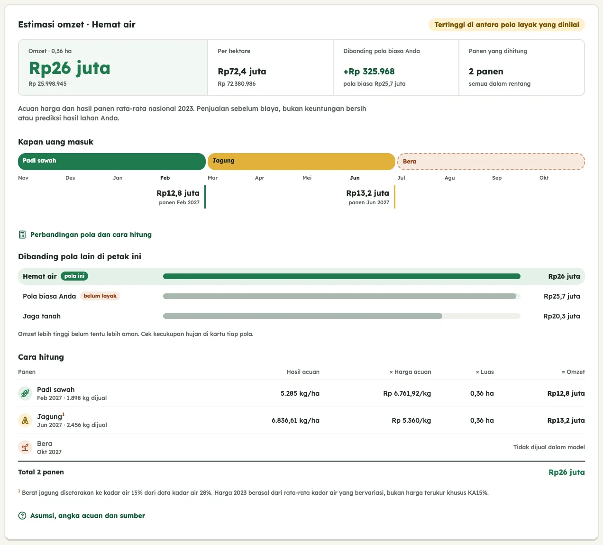
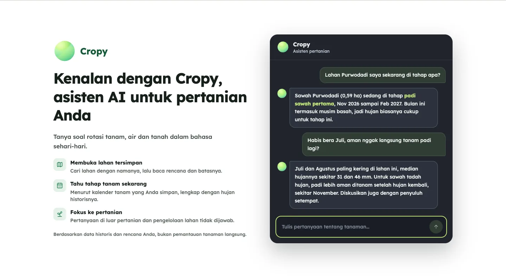

<p align="center">
    
</p>

<h1 align="center">TANI</h1>

<p align="center"><em>Adapt your planting to your field's climate and soil.</em></p>

<p align="center">
    A crop rotation decision support tool for small farms in Indonesia. It compares a farmer's usual<br>
    rotation with alternatives using ten years of NASA POWER climate data, SoilGrids soil data and crop rules.
</p>

<p align="center">
    <a href="#how-it-works">How it works</a> ·
    <a href="#features">Features</a> ·
    <a href="#method">Method</a> ·
    <a href="#limitations-and-next-steps">Limitations</a> ·
    <a href="#running-locally">Running locally</a> ·
    <a href="#attributions-and-copyright">Attributions and copyright</a>
</p>

<p align="center">
    
</p>

<p align="center">
    
    
    
    
    
</p>

## Overview

TANI is the entry of team **Tree Plex** (Jakarta, Indonesia) for the 2026 NASA Space Apps Challenge **Field Shift: Adapting Farms with NASA Data**. The challenge asks for a tool that combines NASA Earth observations with soil information, crop characteristics and farmer priorities, so farmers can explore crop rotations that protect soil and adapt to changing weather and water.

TANI focuses on small rice farms in Indonesia, starting with Grobogan, Central Java. A farmer outlines a field on satellite imagery, enters the usual planting order, the start month, the planning period and the water source. TANI then:

- **Reads the field's climate history** from NASA POWER: daily rain, temperature, humidity and solar radiation for 2016 to 2025, summarised per month.
- **Reads the field's soil** from SoilGrids 2.0: pH, organic carbon and texture for 0 to 30 cm.
- **Checks the usual rotation** against five feasibility rules, including how often rain was enough for each stage in the reference years.
- **Suggests up to three other rotations** from a library of ten candidates, each chosen for one priority: saving water, caring for soil or estimated revenue.
- **Explains every suggestion** with month by month calendars, five side by side dimensions, risks and the evidence behind them, in Indonesian or English.
- **Answers follow-up questions** through Cropy, an assistant that can open the farmer's saved fields and rerun the analysis.

Results are historical frequencies, not forecasts. The tool supports the farmer's own judgment and local extension officers and does not replace them.

## How it addresses the challenge

| Challenge objective                                          | What TANI does                                                                                                             |
| ------------------------------------------------------------ | -------------------------------------------------------------------------------------------------------------------------- |
| Use NASA Earth observations                                  | NASA POWER daily data for ten complete years drives every climate rule and chart                                           |
| Local soil information                                       | SoilGrids 2.0 pH, organic carbon and texture averaged over the field outline                                               |
| Crop characteristics                                         | A curated table of five crops and fallow with FAO ECOCROP temperature and pH limits, water needs and planting order rules  |
| Farmer priorities                                            | Water source (rainfed or irrigated) changes the rules, and alternatives are picked for water saving, soil care and revenue |
| Compare at least three strategies including the existing one | The usual rotation is always shown next to up to three alternatives                                                        |
| Explain why, evidence, benefits, gaps and risks              | Each strategy lists its reasons, trade offs, risks, years with enough rain and the data sources                            |
| Bare field periods and vulnerable seasons                    | Bare months are counted per strategy and each month is classed as wet, humid or dry                                        |
| Supplemental income                                          | An estimated sales value per strategy from 2023 national prices and yields                                                 |
| Support, not replace, local expertise                        | Every result reminds the user to check with a local extension officer                                                      |

## How it works

1. **Pick the field.** Search a village or type coordinates, then tap the corners of the field on Esri satellite imagery. The area is measured in the browser.

<p align="center">
    
</p>

2. **Fill in the plan.** Choose the usual order of crops and fallow months, a start month from the current month up to 11 months ahead, a period of 6, 12, 18 or 24 months, and whether the field is rainfed or irrigated.
3. **Analyse.** The backend reads the cached NASA POWER and SoilGrids data for the field, evaluates the usual rotation and every candidate rotation, and selects the alternatives. The analysis itself is deterministic.
4. **Explain.** An LLM rewrites the computed evidence into short points per stage. If the LLM is unavailable, the evidence written by the engine is shown instead.
5. **Compare.** The results page shows the field through the season month by month, the soil, the strategy cards, the five dimensions, the reasons and the estimated revenue.

<p align="center">
    
</p>

Signed in users can save a field and open it again later from their dashboard. Opening a saved field reruns the analysis with the latest data.

## Features

### Choose a rotation strategy

The usual rotation sits next to the alternatives. Each card shows whether the pattern passes the rules, its estimated revenue, how often rain was enough, the bare months and the soil care score. Selecting a card switches the whole page to that strategy.

<p align="center">
    
</p>

### Compare them and see why

Five dimensions are shown side by side without a combined score, so a trade off stays visible. The panel next to it explains each stage with its evidence, such as the number of years with enough rain, and states which rule failed. The screenshot shows the field from the [worked example](#worked-example).

<p align="center">
    
</p>

### See the estimated revenue

The revenue card shows the total for the field, the value per hectare, the difference with the usual pattern and the month each harvest brings money in. The comparison with other patterns, the calculation table and the sources open on request.

<p align="center">
    
</p>

### Ask Cropy

Cropy answers questions about rotation, water and soil, and can open a signed in user's saved fields to report the current stage and the field's rain history.

<p align="center">
    
</p>

## Method

This section explains where the numbers come from and how the strategies are chosen.

### Data sources

| Source                                                                                                                                      | What is used                                                                                   | Resolution and period                                                       | Role                                                                                           |
| ------------------------------------------------------------------------------------------------------------------------------------------- | ---------------------------------------------------------------------------------------------- | --------------------------------------------------------------------------- | ---------------------------------------------------------------------------------------------- |
| [NASA POWER](https://power.larc.nasa.gov/)                                                                                                  | `T2M`, `T2M_MIN`, `T2M_MAX`, `PRECTOTCORR`, `RH2M`, `ALLSKY_SFC_SW_DWN`, community `AG`, daily | Meteorology about 0.5° x 0.625°, the last ten complete years (2016 to 2025) | Monthly rain, temperature, humidity and radiation for the field. Main input of rules K2 and K5 |
| [SoilGrids 2.0](https://soilgrids.org/) (ISRIC)                                                                                             | pH in water, soil organic carbon, sand, silt, clay                                             | 250 m, 0 to 30 cm, weighted by the pixels inside the field                  | Soil card, USDA texture and rule K3                                                            |
| [FAO ECOCROP](https://ecocrop.apps.fao.org/) and FAO water guides                                                                           | Absolute temperature and pH limits, water needs                                                | Per crop                                                                    | Crop table used by rules K2, K3 and K5                                                         |
| Kementan (Ministry of Agriculture of Indonesia)                                                                                             | 2023 producer prices and yields                                                                | National averages                                                           | Estimated revenue                                                                              |
| [Esri World Imagery (Clarity)](https://www.esri.com/arcgis-blog/products/imagery/imagery/world-imagery-clarity-a-clearer-view-of-the-world) | Satellite basemap tiles                                                                        | Varies by location                                                          | Drawing and showing the field                                                                  |
| [Nominatim](https://nominatim.org/) (OpenStreetMap)                                                                                         | Place search                                                                                   |                                                                             | Finding a village by name                                                                      |
| [Natural Earth](https://www.naturalearthdata.com/)                                                                                          | Country outlines                                                                               | 1:50m                                                                       | Maps on the landing page                                                                       |

NASA POWER is cached for Indonesia in ten regional tiles covering 94° E to 142° E and 12° S to 7° N. SoilGrids rasters are cached for the Grobogan demo area. Outside the soil cache, the analysis runs without soil and rule K3 is skipped. The crop list was assembled for Grobogan and may not fit other regions.

A climate value describes the POWER grid cell, about 50 km across, not the plot itself. Two nearby fields get the same climate profile.

### Rotation engine

The engine lives in [`backend/app/core/`](backend/app/core) and does not train a model. Every strategy, including the usual one, goes through the same five rules:

| Rule | Checks                    | Fails when                                                                                                                                            |
| ---- | ------------------------- | ----------------------------------------------------------------------------------------------------------------------------------------------------- |
| K1   | Calendar                  | Stages leave gaps or overlap                                                                                                                          |
| K2   | Temperature               | A month's median mean temperature is outside the crop's absolute limits                                                                               |
| K3   | Soil pH                   | The field's pH is outside the crop's limits. Skipped when soil data is missing                                                                        |
| K4   | Planting order            | A crop follows a crop it should not follow                                                                                                            |
| K5   | Rain, rainfed fields only | Rain over a stage reaches the crop's lower water need in less than 60% of the reference years, or rice has wet months for less than half of its stage |

Months are classed from the median rain of the ten years: wet above 200 mm, humid from 100 to 200 mm and dry below 100 mm. Margins close to a limit are reported as risks instead of failures.

Feasible candidates are compared on five dimensions shown side by side, without a combined score:

| Dimension         | Meaning                                                             |
| ----------------- | ------------------------------------------------------------------- |
| Climate fit       | Months where temperature is within the crop's range                 |
| Water pressure    | How often rain was enough at the weakest stage                      |
| Bare months       | Months the field is left without a crop                             |
| Soil contribution | Legumes, cover crops and number of crop families                    |
| Risks             | Notes such as near limits, missing data or approximated water needs |

The selector picks one alternative per role: water saving and soil care when a usual pattern is given, a balanced option when it is not, and the highest estimated revenue among all feasible patterns. Thresholds and decisions are documented in [rotation-engine.md](backend/contracts/rotation-engine.md).

### Worked example

The usual rotation of a 0.36 ha rainfed field near Purwodadi, Grobogan, is rice, rice, then 4 fallow months, starting November 2026 for 12 months. The engine returns:

| Strategy      | Rotation                | Feasibility |  Rain enough | Bare months | Legume | Estimated revenue |
| ------------- | ----------------------- | ----------- | -----------: | ----------: | ------ | ----------------: |
| Usual pattern | Rice, rice, fallow      | Fails K5    | 9 of 9 years |           4 | No     |    Rp25.7 million |
| Water saving  | Rice, maize, fallow     | Passes      | 8 of 9 years |           4 | No     |    Rp26.0 million |
| Soil care     | Rice, mung bean, fallow | Passes      | 9 of 9 years |           6 | Yes    |    Rp20.3 million |

Rain over the whole second rice stage is enough in every reference year, but that stage falls from March to June, when less than half of the months are wet. Rainfed rice needs mostly wet months, so the usual pattern fails rule K5. Replacing the second rice with maize or mung bean passes.

### Estimated revenue

For each completed harvest, revenue is field area × reference yield × reference price. Prices and yields are 2023 national averages from Kementan publications, the same for every location and month. The values are sales before costs, not profit and not a price forecast. Maize weight is converted from 28% to 15% moisture. Harvests after the analysis period are not counted. Sunn hemp and fallow have no modelled sales. Details are in [revenue.md](backend/contracts/revenue.md).

### Cropy

Cropy is a chat assistant on the app pages. It answers questions about crop rotation, water and soil in Indonesian or English. For a signed in user it can call two read only tools: one finds saved fields by name and the other reads a saved field's plan, its current planned stage, its area and a fresh climate and soil analysis. Ownership is checked against the session on every call.

Each message is first checked by a classifier, and requests outside farming and land management are refused. Messages are limited to 2,000 characters, and the API process accepts five chat requests per minute. Cropy has no live crop monitoring or weather feed, so planned stages are not evidence of actual crop growth.

## Limitations and next steps

TANI is built to compare rotation options with public data, so each result is a starting point for a conversation with the farmer and a local extension officer. These are the current scope choices and how they can grow:

- **Rain is a modelled estimate.** POWER `PRECTOTCORR` is a satellite and model based product. It has not yet been compared with NASA GPM IMERG or rain gauges in Indonesia, which is the next step for checking the rain rule.
- **Area scale data.** Climate describes a POWER grid cell about 50 km across and soil a 250 m pixel. This suits comparing seasons and patterns for an area, while plot level detail comes from the farmer's own knowledge of the field.
- **Built on history.** "Enough in 8 of 9 years" summarises the past ten years. It shows how reliable a season has been, not a forecast for the next one.
- **Rain based water check.** The water rule compares rain with each crop's need, and irrigated fields skip it. Evapotranspiration and soil moisture, for example from NASA SMAP, are a natural extension.
- **Revenue as a common reference.** Estimates use 2023 national prices and yields, so every pattern is compared on the same basis. Local prices, costs and the field's own yield can be added later.
- **Crop list focused on Grobogan.** Five crops and fallow (rice, maize, soybean, mung bean and sunn hemp) cover the main patterns there. Other regions can be added with their own crop table.

## Architecture

| Component   | Technology                                                                                      | Role                                                                                                               |
| ----------- | ----------------------------------------------------------------------------------------------- | ------------------------------------------------------------------------------------------------------------------ |
| Frontend    | Next.js 16 App Router, TypeScript, Tailwind CSS 4, MapLibre GL, Terra Draw, Turf, Framer Motion | Landing page, field drawing, plan form, results, dashboard and chat panel. Hosted on Vercel                        |
| Backend     | FastAPI, Pydantic, rasterio, httpx                                                              | Analysis, geocoding, accounts, saved fields and chat under `/api/v1`. Runs as a Docker image on a VPS behind Nginx |
| Database    | PostgreSQL (Neon in production)                                                                 | Accounts, sessions and saved fields                                                                                |
| Data caches | JSON and GeoTIFF files                                                                          | NASA POWER and SoilGrids archives, built by scripts and shared as checksummed ZIP files                            |
| LLM         | OpenAI Chat Completions                                                                         | Explanation text and the Cropy assistant. Optional for the analysis                                                |

The browser calls the backend through the Next.js origin, which forwards `/api/*`. NASA POWER, SoilGrids, Nominatim and the LLM are reached only from the backend. On every push to `main`, GitHub Actions runs the frontend tests, the build and the backend tests, then builds the backend image, publishes it to GitHub Container Registry and deploys it over SSH. Vercel deploys the frontend from the same branch. See [deploy/backend/README.md](deploy/backend/README.md).

## Running locally

Requires Node.js 22.9 or newer, npm and Python 3.12 or newer (CI uses 3.12).

```sh
npm ci
python3 -m venv backend/.venv
backend/.venv/bin/python -m pip install -r backend/requirements-dev.lock.txt
cp frontend/.env.example frontend/.env.local
cp backend/.env.example backend/.env
```

Extract the NASA POWER and SoilGrids cache archives as described in [backend/cache-archives/README.md](backend/cache-archives/README.md). Without the climate cache the analysis returns HTTP 502. `AI_API_KEY` in `backend/.env` is optional and enables the explanations and Cropy. `DATABASE_URL` enables accounts and saved fields.

Run the backend and the frontend in two terminals:

```sh
npm run dev:backend
npm run dev
```

The app runs at http://localhost:3000 and the API documentation at http://127.0.0.1:8000/docs.

Checks:

```sh
npm test                                   # frontend and shared unit tests
npm run build
cd backend && .venv/bin/python -m pytest -q
```

Browser tests use Playwright, see [frontend/README.md](frontend/README.md). More setup detail, including the local PostgreSQL container and the map providers, is in [docs/development.md](docs/development.md).

## Project layout

```
frontend/
├── app/            routes: landing, /lahan input, /hasil results, login and account
├── components/     landing, input flow, results, account, agent chat
└── lib/            API client, i18n (Indonesian and English), formatting
backend/
├── app/core/       rotation engine: calendar, rules, dimensions, selector, revenue
├── app/services/   NASA POWER, SoilGrids, geocoding, analysis, explanations, chat
├── data/           crop table, rotation library, economics, cache folders
├── contracts/      API and method documents
└── scripts/        cache downloads and checks
packages/shared/    location types and coordinate parsing shared by frontend code
deploy/backend/     Docker Compose, Nginx and deployment guide
docs/               development notes and README images
```

The product requirements are in the [PRD](<PRD Field Shift Alat Bantu Rotasi Tanam Berbasis Data NASA.md>) and the target architecture in [architecture.md](architecture.md), both in Indonesian.

## Team

**Tree Plex**, NASA Space Apps Challenge 2026, local event Jakarta, Indonesia.

- Muhammad Zaid Ats Tsabit
- Priyapta Naufal Sudrajat
- Muhammad Naufal Ramadhan

## Attributions and copyright

Every source used to build TANI is cited below, including open source software and freely available data. Each item keeps its own license and terms. No NASA logo, flag or mission identifier is used in the app, the README or the demo video.

### Data

| Source | Used for | License or terms |
| --- | --- | --- |
| [NASA POWER](https://power.larc.nasa.gov/) | Daily rain, temperature, humidity and solar radiation, 2016 to 2025 | Climate data was obtained from the NASA Langley Research Center (LaRC) POWER Project funded through the NASA Earth Science/Applied Science Program. |
| [SoilGrids 2.0](https://soilgrids.org/), ISRIC | Soil pH, organic carbon and texture | [CC BY 4.0](https://creativecommons.org/licenses/by/4.0/). Poggio, L., de Sousa, L. M., Batjes, N. H., Heuvelink, G. B. M., Kempen, B., Ribeiro, E., and Rossiter, D. (2021). SoilGrids 2.0: producing soil information for the globe with quantified spatial uncertainty. *SOIL*, 7, 217 to 240. https://doi.org/10.5194/soil-7-217-2021 |
| [FAO ECOCROP](https://ecocrop.apps.fao.org/ecocrop/srv/en/home) | Crop temperature and pH limits | FAO terms of use. Every value and its page is listed in [sources.json](backend/data/catalog/sources.json) |
| Kementan (Ministry of Agriculture of Indonesia) | 2023 prices and yields | Public statistics: [Statistik Harga Komoditas Pertanian 2025](https://satudata.pertanian.go.id/assets/docs/publikasi/c9c87ec57f8a22249659ace0dc306047.pdf), [Statistik Pertanian 2024](https://satudata.pertanian.go.id/assets/docs/publikasi/STATISTIK_PERTANIAN_2024_c.pdf), [Outlook Jagung 2024](https://satudata.pertanian.go.id/assets/docs/publikasi/Outlook_Jagung_2024_Final.pdf). Tables and pages are listed in [national-2023.json](backend/data/economics/national-2023.json) |
| BPS, [Sensus Pertanian 2023](https://sensus.bps.go.id/) | Farm household figures on the landing page | Public statistics |
| [Natural Earth](https://www.naturalearthdata.com/) | Country outlines for the landing maps | Public domain, see [terms of use](https://www.naturalearthdata.com/about/terms-of-use/) |
| [Nominatim](https://nominatim.org/) and [OpenStreetMap](https://www.openstreetmap.org/copyright) | Place search | © OpenStreetMap contributors, data available under the Open Database License |

The NASA POWER and SoilGrids caches are not stored in this repository. The curated tables in `backend/data/` hold only the values used by the app, with their sources.

### Maps and imagery

| Source | Used for | Attribution |
| --- | --- | --- |
| [Esri World Imagery (Clarity)](https://www.esri.com/arcgis-blog/products/imagery/imagery/world-imagery-clarity-a-clearer-view-of-the-world) | Satellite basemap for drawing and showing fields | Esri, Vantor, Earthstar Geographics, IGN, and the GIS User Community. Esri terms of use apply |
| Esri World Street Map | Street basemap | Esri, HERE, Garmin, USGS, and the GIS User Community |
| [MapTiler](https://www.maptiler.com/) terrain, optional | Elevation terrain when a key is configured | MapTiler terms of use |

The attribution of each basemap stays visible on the map in the app.

### Images

| Image | Used on | Source |
| --- | --- | --- |
| Aerial photo of rice fields, [`login-sawah.jpg`](frontend/public/images/login-sawah.jpg) | Landing page hero and the sign in page | AI generated. It is an illustration, not a photo of a real field. The outlined plot and its 0.59 ha label are drawn on top by the app |

### Fonts and icons

| Asset | License |
| --- | --- |
| [Lexend](https://fonts.google.com/specimen/Lexend) | SIL Open Font License 1.1 |
| [Lucide](https://lucide.dev/) icons | ISC |

### Software

| Project | License |
| --- | --- |
| [Next.js](https://nextjs.org/), [React](https://react.dev/) | MIT |
| [Tailwind CSS](https://tailwindcss.com/) | MIT |
| [MapLibre GL JS](https://maplibre.org/) | BSD 3-Clause |
| [Terra Draw](https://terradraw.io/) | MIT |
| [Turf.js](https://turfjs.org/) | MIT |
| [Motion](https://motion.dev/) (framer-motion), [anime.js](https://animejs.com/) | MIT |
| [TypeScript](https://www.typescriptlang.org/), [Playwright](https://playwright.dev/) | Apache 2.0 |
| [FastAPI](https://fastapi.tiangolo.com/), [Pydantic](https://docs.pydantic.dev/), [pyproj](https://pyproj4.github.io/pyproj/) | MIT |
| [httpx](https://www.python-httpx.org/), [Uvicorn](https://github.com/encode/uvicorn), [rasterio](https://rasterio.readthedocs.io/), [Shapely](https://shapely.readthedocs.io/), [NumPy](https://numpy.org/) | BSD |
| [psycopg](https://www.psycopg.org/) | LGPL 3.0 |

### Services

| Service | Used for | Terms |
| --- | --- | --- |
| [OpenAI API](https://platform.openai.com/) | Short explanation of each strategy and the Cropy assistant | OpenAI terms of use |
| [Vercel](https://vercel.com/), GitHub Actions, GitHub Container Registry | Hosting, tests and deployment | Provider terms |

### Demo video

| Asset | Used for | License or terms |
| --- | --- | --- |
| "Ambient Corporate Startup Promo" by alex-morgan, from [Pixabay](https://pixabay.com/id/music/search/technology%20corporate/) | Background music | [Pixabay Content License](https://pixabay.com/service/license-summary/) |
| Screen recordings of TANI | Every app scene | Recorded by Tree Plex from the running app |
| Aerial image of rice fields | Opening scenes | AI generated, the same image as the landing page |
| Voice over | Narration | Recorded by Tree Plex |
| [Playwright](https://playwright.dev/) | Recording the app scenes | Apache 2.0 |
| [FFmpeg](https://ffmpeg.org/) | Encoding the video and mixing audio | GPL 3.0 build with x264 |
| [whisper.cpp](https://github.com/ggml-org/whisper.cpp) | Transcribing the voice over to align it with the scenes | MIT |

### Copyright

The code and documentation in this repository are © 2026 Tree Plex. Third party data, imagery, fonts, icons and software remain the property of their owners and are used under the licenses listed above.
