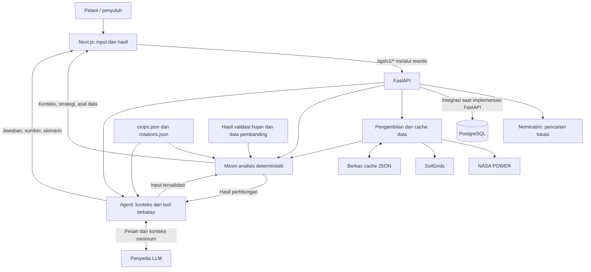

# Arsitektur Field Shift

Status: arsitektur target MVP, belum seluruhnya diimplementasikan.

Acuan: [PRD Field Shift](<PRD Field Shift Alat Bantu Rotasi Tanam Berbasis Data NASA.md>), terutama bagian 5–12 dan kriteria penerimaan bagian 13. Seluruh endpoint aplikasi memakai prefix `/api/v1`, termasuk agent AI.

## 1. Keputusan arsitektur

| Bagian | Pilihan |
| --- | --- |
| Frontend | Next.js App Router, TypeScript, Tailwind CSS |
| Backend | FastAPI, Pydantic, pandas, httpx |
| Komunikasi | JSON melalui HTTP dengan prefix `/api/v1` |
| Penyimpanan | PostgreSQL 17 melalui Docker Compose untuk database aplikasi; JSON tetap untuk data kurasi, validasi hujan, dan cache demo |
| Iklim | NASA POWER, sepuluh tahun kalender lengkap terakhir |
| Tanah | SoilGrids, kedalaman agregat 0–30 cm |
| Pencarian lokasi | Nominatim melalui backend |
| Agent AI | DeepSeek melalui Chat Completions; model awal `deepseek-flash`, dapat diatur lewat `AI_MODEL`; tool analisis menyusul setelah pipeline tersedia |
| Hosting target | Frontend di Vercel, backend di Render |

Frontend mengumpulkan empat input, menampilkan hasil, dan menyediakan panel tanya AI. Seluruh perhitungan yang menentukan strategi dilakukan backend. LLM dipakai untuk percakapan dan pemilihan tool; mesin analisis tidak melatih model ML. Tidak ada login, prediksi panen, perhitungan keuntungan, atau skor gabungan.



Browser memanggil API aplikasi melalui origin Next.js. NASA POWER, SoilGrids, Nominatim, dan penyedia LLM hanya dipanggil backend. Ubin peta tetap dimuat oleh komponen peta dari penyedia basemap. Endpoint analisis tidak bergantung pada layanan AI.

## 2. Routing frontend

| Route Next.js | Isi |
| --- | --- |
| `/` | Input lokasi, pola rotasi, waktu, dan sumber air |
| `/hasil` | Ringkasan lokasi, kalender, strategi, dan panel asal data |

Kedua layar memiliki panel `AgentChat`, tanpa route halaman chat tambahan. Chat opsional bagi petani dan tidak menambah input wajib. Pada layar input, pertanyaan umum memakai referensi tanaman; jawaban spesifik lahan memerlukan empat input lengkap.

Input hasil disimpan di query string agar halaman bisa dimuat ulang atau dibagikan:

```text
/hasil?lat=-7.09&lon=110.91&pola=padi_sawah,padi_sawah,bera:4&mulai=2026-11&horizon=12&air=tadah_hujan&lang=id
```

- `pola=kosong` berarti pengguna belum punya pola, berbeda dengan bera.
- Horizon tersedia: 6, 12, 18, atau 24 bulan; default 12.
- Bulan mulai default bulan berjalan, dapat digeser sampai 11 bulan ke depan.
- Bahasa default Indonesia; `lang=en` memilih Inggris dan ikut dikirim ke backend.
- Tanggal contoh di dokumen bukan nilai tetap aplikasi.

Komponen input mengikuti PRD: `MapPicker`, `LocationSearch`, `RotationBuilder`, `TimeControl`, dan `WaterSourceToggle`. Komponen hasil: `ClimateCalendar`, `SoilSummary`, `StrategyCard`, `RotationTimeline`, `DimensionList`, dan `ProvenancePanel`. `LanguageToggle` dipakai di kedua layar.

`useAnalysis` membaca input dari URL dan memanggil endpoint analisis. Perubahan waktu atau sumber air memperbarui URL, lalu menghitung ulang dengan debounce 300 ms. Hasil sebelumnya tetap tampil redup selama pemuatan; respons permintaan lama tidak boleh menimpa hasil permintaan terbaru. Pencarian lokasi memakai debounce 500 ms.

Frontend hanya memformat angka dan tanggal. Daftar tanaman berasal dari backend, dan teks alasan, kompromi, serta risiko mengikuti `lang`. Tampilan menyediakan status memuat, galat, hasil parsial, dan pilihan yang tidak mencukupi.

`useAgentChat` mengirim pesan, maksimal 10 pesan riwayat, dan empat input aktif ke `/api/v1/agent/chat`. Riwayat berada di memori tab, tidak di URL atau LocalStorage. Reset percakapan saat input analisis atau bahasa berubah, batalkan/abaikan respons lama, dan sediakan hapus percakapan. Percobaan ulang tidak menambahkan pesan pengguna yang sama dua kali. Jawaban diberi penanda AI, sumber yang bisa dibuka, dan skenario bila tersedia. Render sebagai teks atau Markdown yang disanitasi tanpa HTML mentah; tautan sumber berasal dari daftar backend.

## 3. Routing backend `/api/v1`

Lima endpoint aplikasi mencakup empat endpoint analisis inti dan satu endpoint agent sesuai bagian 12.4 PRD:

| Method | Endpoint | Input | Hasil | Kebutuhan PRD |
| --- | --- | --- | --- | --- |
| `POST` | `/api/v1/analyze` | Empat input dan `lang` dalam JSON | Konteks iklim/tanah, strategi, catatan, dan asal data | F-02, F-07 sampai F-18, F-22, F-23 |
| `GET` | `/api/v1/crops` | `lang=id\|en`, default `id` | Daftar tanaman terkurasi untuk penyusun rotasi, termasuk bera | F-03, F-22 |
| `GET` | `/api/v1/geocode` | `q` | Hasil pencarian lokasi di wilayah demo | F-01 |
| `GET` | `/api/v1/health` | Tidak ada | Status hidup backend | Operasional demo |
| `POST` | `/api/v1/agent/chat` | Pesan, riwayat terbatas, input analisis opsional, bahasa | Jawaban, sumber, dan hasil skenario opsional | F-24 sampai F-28 |

Tidak diperlukan endpoint terpisah untuk iklim, tanah, strategi, provenance, atau hitung ulang: semuanya dikembalikan oleh `/analyze`. Pola pengguna dan hasil tidak disimpan sebagai resource server, sehingga MVP tidak membutuhkan endpoint CRUD farm atau analisis tersimpan.

### `POST /api/v1/analyze`

Contoh permintaan mengikuti kontrak bagian 7 PRD:

```json
{
  "location": { "lat": -7.09, "lon": 110.91 },
  "rotation": {
    "has_pattern": true,
    "stages": [
      { "crop_id": "padi_sawah" },
      { "crop_id": "padi_sawah" },
      { "crop_id": "bera", "months": 4 }
    ]
  },
  "time": { "start_month": "2026-11", "horizon_months": 12 },
  "water_source": "tadah_hujan",
  "lang": "id"
}
```

Validasi backend:

- Koordinat harus angka terbatas, lintang −90 sampai 90 dan bujur −180 sampai 180. Titik di luar Grobogan diterima dengan peringatan.
- `has_pattern=true` membutuhkan 1–6 tahap; `false` membutuhkan daftar tahap kosong.
- `crop_id` harus terdaftar. Durasi tanaman mengikuti tabel; hanya bera menerima `months`, bilangan bulat 1–6.
- `start_month` berformat `YYYY-MM` dan berada antara bulan berjalan dan 11 bulan berikutnya. Validasi batas bulan memakai zona waktu `Asia/Jakarta` agar server dan pengguna wilayah demo konsisten.
- `horizon_months` hanya 6, 12, 18, atau 24.
- `water_source` hanya `tadah_hujan` atau `irigasi`; `lang` hanya `id` atau `en`, default `id`.

Struktur respons tetap mengikuti PRD:

| Field | Isi |
| --- | --- |
| `context.climate` | Periode data dan profil 12 bulan: hujan, suhu, radiasi, kelembapan, kelas bulan, jumlah tahun sah |
| `context.soil` | Status tersedia/tidak tersedia, kedalaman, tekstur, pH, karbon organik, ketidakpastian |
| `strategies[]` | Identitas, peran, label, kalender, aturan kelayakan, lima dimensi, alasan, kompromi |
| `notes[]` | Peringatan wilayah, keterbatasan data, alasan alternatif tidak lengkap |
| `provenance` | Sumber, periode, waktu pengambilan, resolusi, hari hilang, validasi hujan, versi tabel, asumsi |

Dengan pola pengguna, hasil menampilkan pembanding `pola_biasa` dan maksimal dua alternatif: `hemat_air` serta `jaga_tanah`. Pembanding tetap ditampilkan walaupun gagal aturan kelayakan. Tanpa pola pengguna, hasil berisi maksimal tiga alternatif: `hemat_air`, `jaga_tanah`, dan `seimbang`. Bila kandidat layak kurang, kembalikan yang tersedia beserta penjelasannya dengan status 200.

Schema backend dan tipe frontend memakai empat nilai `role` tersebut sesuai bagian 7 PRD. Nilai enum tetap sama pada kedua bahasa; label dan narasi diterjemahkan.

### `GET /api/v1/crops?lang=id`

Mengembalikan tanaman terkurasi: `padi_sawah`, `jagung`, `kedelai`, `kacang_hijau`, `orok_orok`, dan `bera`. ID ini dipakai konsisten di berkas kurasi, permintaan analisis, dan respons.

Setiap entri menyediakan `crop_id`, nama sesuai bahasa, peran, dan `slot_bulan`. Bera memakai `slot_bulan=null` karena durasinya dipilih pengguna dalam batas 1–6 bulan. Frontend tidak menduplikasi tabel tanaman. Kisaran suhu, pH, kebutuhan air, dan sumber agronomi lengkap tetap disimpan di `data/crops.json` untuk mesin analisis.

### `GET /api/v1/geocode?q=Purwodadi`

Backend memvalidasi `q`, memanggil Nominatim dengan batas wilayah demo, lalu menormalisasi respons. Hasil kosong dikembalikan sebagai daftar kosong agar pengguna dapat memilih titik di peta.

Gunakan bentuk hasil yang sudah dikenali komponen pencarian saat ini:

```json
{
  "results": [
    {
      "id": "demo-purwodadi",
      "name": "Purwodadi, Grobogan, Jawa Tengah",
      "center": [110.91, -7.09],
      "zoom": 14
    }
  ]
}
```

Contoh ini menunjukkan bentuk data, bukan respons geocoding nyata. `center` berurutan `[lon, lat]`, sedangkan input analisis memakai objek `{ lat, lon }`. Frontend harus memetakannya dengan benar.

Panggilan keluar Nominatim dibatasi maksimal satu permintaan per detik secara bersama untuk proses backend, dengan `NOMINATIM_USER_AGENT`. Cache pencarian yang sudah ada dapat dipertahankan dalam migrasi. Jika batas layanan aplikasi tercapai, kembalikan 429 dengan `Retry-After`.

### `GET /api/v1/health`

```json
{ "status": "ok" }
```

Pemeriksaan hidup ini tidak memanggil penyedia data luar. Gunakan untuk memeriksa proses dan membangunkan backend sebelum presentasi; hasilnya tidak menjamin NASA POWER atau SoilGrids sedang tersedia.

### Status dan galat

| Status | Kondisi |
| --- | --- |
| `200` | Berhasil, termasuk hasil parsial, kandidat kurang, dan pencarian kosong |
| `400` | Input tidak sah; respons menyebut field yang salah |
| `429` | Batas permintaan pencarian atau batas laju/kuota chat tercapai |
| `502` | POWER gagal tanpa cache, penyedia pencarian gagal, atau penyedia AI gagal |
| `503` | Fitur AI belum dikonfigurasi |
| `504` | Deadline total chat 30 detik tercapai |
| `500` | Galat internal yang tidak diperkirakan; detail internal tidak dikirim ke pengguna |

Kegagalan SoilGrids menghasilkan `200` dengan `context.soil.status="unavailable"`; aturan K3 dilewati dan penilaian parsial diberi label. Nilai tanah tidak diisi dengan angka buatan.

FastAPI harus memetakan galat validasi permintaan ke 400 sesuai kontrak PRD. Bentuk galat yang disepakati untuk frontend:

```json
{
  "detail": [
    {
      "loc": ["body", "time", "horizon_months"],
      "msg": "Pilih horizon 6, 12, 18, atau 24 bulan."
    }
  ]
}
```

## 4. Pembagian backend dan alur analisis

Route FastAPI memvalidasi permintaan, memanggil pipeline atau service agent, dan memetakan galat. Daftarkan router aplikasi sekali dengan prefix `/api/v1` agar prefix tidak diulang pada setiap handler.

```text
backend/
  app/
    main.py                  # aplikasi, router, penanganan validasi
    schemas.py               # kontrak request/response
    config.py                # konfigurasi lingkungan
    api/routes.py            # empat endpoint inti
    api/agent.py             # endpoint chat dan batas penggunaan
    services/
      power.py               # NASA POWER dan pembersihan data
      soil.py                # SoilGrids dan konversi satuan
      geocode.py             # Nominatim, cache, batas laju
      cache.py               # baca/tulis cache JSON
      agent.py               # konteks, dua tool, validasi sumber
      llm.py                 # integrasi penyedia AI yang dipilih
    core/
      climate.py             # agregasi dan jendela tahun historis
      rotation.py            # kalender pembanding dan kandidat
      feasibility.py         # aturan K1–K5
      dimensions.py          # lima dimensi perbandingan
      selector.py            # pemilihan alternatif yang berbeda
      explain.py             # narasi id/en dari hasil perhitungan
      pipeline.py            # menyusun langkah analisis
  data/
    crops.json
    rotations.json
    validation/              # ringkasan dan data pembanding demo
    cache/power/
    cache/soil/
  scripts/validate_rain.py    # validasi sekali jalan di luar request
  tests/
  requirements.txt
```

Alur `POST /api/v1/analyze`:

1. Validasi empat input dan bahasa.
2. Ambil iklim dan tanah melalui service secara bersamaan dengan `asyncio.gather`, memakai cache lebih dahulu. Timeout POWER 15 detik dan SoilGrids 8 detik sesuai PRD. Service tanah menangani kegagalannya sebagai status tidak tersedia.
3. Bangun profil bulanan dan jendela historis berurutan. Per November 2026, periode acuannya 2016–2025, bergantung kelengkapan data yang benar-benar diambil.
4. Ulangi pola pengguna dari tahap pertama dan bentuk kandidat dari pustaka pola; tandai tahap yang melewati horizon.
5. Saring kandidat dengan K1–K5: kalender, suhu absolut, pH bila tersedia, aturan urutan bersumber, dan kecukupan hujan untuk tadah hujan.
6. Hitung kesesuaian iklim, tekanan air, bulan bera, kontribusi tanah secara kualitatif, serta risiko. K5 memakai ambang minimal 60% jendela historis; untuk irigasi tidak menggugurkan kandidat dan hasilnya menjelaskan ketergantungan pada irigasi.
7. Pilih alternatif yang berbeda dari pembanding dan satu sama lain, sesuai prioritas bagian 10 PRD.
8. Rakit narasi sesuai bahasa dari angka hasil hitung, sertakan metadata sumber dan keterbatasan, lalu kirim respons.

Fungsi di `core/` menerima data dan mengembalikan hasil tanpa jaringan. Input yang sama dan cache yang sama menghasilkan hasil yang sama. Teks LLM dapat berbeda, tetapi angka dan kelayakan harus berasal dari pipeline ini. Teks alasan pada respons `/analyze` tetap memakai templat deterministik.

## 5. Cache dan ketahanan demo

| Data | Kunci dan perilaku |
| --- | --- |
| POWER | Sel grid menurut sumber; simpan periode, satuan, hari hilang, waktu pengambilan. Jangan membulatkan koordinat sembarang dan menyebutnya sel grid. |
| SoilGrids | Koordinat dibulatkan tiga desimal; simpan juga status gagal selama hackathon agar layanan tidak dipanggil berulang |
| Tanaman dan pola | Dibaca saat server mulai; hanya baris bersumber yang dipakai; versi dikirim dalam provenance |
| Validasi hujan | Hasil validasi titik demo dari IMERG/CHIRPS, dimuat dari berkas |

Cache dua titik demo ikut disimpan di repositori agar tetap tersedia setelah restart hosting. `CACHE_DIR` menjadi lokasi cache runtime; berkas demo menjadi bekal awal. Penulisan cache harus atomik agar request bersamaan tidak meninggalkan JSON terpotong.

Validasi hujan dijalankan lewat skrip, bukan endpoint publik. Jika lebih dari 3 bulan berbeda kelas atau selisih tahunan melebihi 25%, gunakan data hujan pembanding yang sudah diunduh untuk demo sesuai PRD; POWER tetap memasok suhu, radiasi, dan kelembapan. Titik lain diberi label belum divalidasi. Tidak ada pemanggilan ClimateSERV dalam jalur request pengguna.

Iklim harus diberi label nilai area, bukan pengukuran petak. Hasil selalu berlabel estimasi berbasis pola historis. Data hilang, aturan yang dilewati, dan asumsi irigasi harus terlihat di hasil.

## 6. Proxy, konfigurasi, dan deployment

Next.js meneruskan `/api/v1/:path*` ke `${API_URL}/api/v1/:path*`. `API_URL` hanya berisi origin backend, tanpa suffix `/api/v1`, dan tidak memakai prefix `NEXT_PUBLIC_`.

Gunakan nama `API_URL` yang sudah ada di repositori dan diselaraskan dalam PRD. Contoh pengembangan target:

```dotenv
# frontend/.env.local
API_URL=http://127.0.0.1:8000
```

| Konfigurasi backend | Fungsi |
| --- | --- |
| `CACHE_DIR` | Direktori cache runtime |
| `DATABASE_URL` | Koneksi PostgreSQL backend; tidak dikirim ke frontend atau LLM |
| `DEMO_BBOX` | Batas wilayah Grobogan untuk peringatan dan pencarian |
| `NOMINATIM_USER_AGENT` | Identitas aplikasi saat mengakses Nominatim |
| `ALLOWED_ORIGINS` | Origin yang diizinkan bila frontend mengakses backend langsung saat pengembangan |
| `AI_API_KEY` | Rahasia penyedia AI, hanya di backend |
| `AI_MODEL` | Model yang dipilih saat implementasi |
| `AI_DAILY_REQUEST_LIMIT` | Kuota chat bersama per proses per hari WIB, default demo 100 |

Perintah backend target dari direktori `backend/`: `uvicorn app.main:app --reload --port 8000`. Frontend tetap dijalankan dengan script Next.js pada port 3000.

Database lokal dijalankan terpisah lewat `docker compose up -d --wait db` dari root repositori. `docker-compose.yml` memakai image `postgres:17`, healthcheck, port `127.0.0.1:5432`, dan named volume persisten. `.env` di root memasok `POSTGRES_DB`, `POSTGRES_USER`, `POSTGRES_PASSWORD`, serta `POSTGRES_PORT`. `backend/.env` memasok `DATABASE_URL` yang sesuai. Password wajib diisi; kredensial hanya untuk backend. Lihat langkah operasional di [README](README.md#local-postgresql-with-docker).

Penyediaan database sudah diimplementasikan; backend FastAPI saat ini belum menggunakannya. Orang 2 menentukan tabel/migrasi ketika kebutuhan data aplikasi diimplementasikan. Penambahan PostgreSQL tidak otomatis memigrasikan field LocalStorage, data kurasi/cache JSON, atau menyimpan chat. Aplikasi tetap tanpa akun dan riwayat chat permanen. Tidak ditambahkan tabel untuk fitur yang belum diminta.

Compose ini untuk pengembangan lokal. Pada deployment Vercel/Render, PostgreSQL berada di layanan terpisah yang dapat diakses backend melalui `DATABASE_URL` produksi; Compose lokal tidak otomatis ikut terdeploy ke Vercel.

Produksi memakai rewrite dari origin frontend sehingga browser tidak perlu CORS lintas origin untuk API. Backend tetap memvalidasi semua input. Konfigurasi hosting harus mengizinkan waktu request di bawah target 20 detik untuk titik baru; target cache di bawah 5 detik. Jalankan backend satu proses untuk MVP agar pembatas Nominatim satu proses berlaku konsisten; deployment multiworker membutuhkan pembatas laju bersama.

Target chat dengan konteks ter-cache di bawah 15 detik, dengan deadline total 30 detik termasuk konteks, tool, dan semua panggilan LLM. Timeout proxy/hosting harus mendukung deadline ini. Jika AI belum dikonfigurasi atau gagal, panel memberi pesan yang jelas dan hasil perbandingan tetap tersedia.

## 7. Migrasi dari kode saat ini

Repositori memakai Next.js dan backend FastAPI. Tabel berikut mencatat rencana migrasi awal; health, katalog tanaman, Nominatim, chat, runner Python, dan proxy port 8000 sudah tersedia. Endpoint analisis dan tool chat masih menunggu integrasi.

| Area | Perubahan saat implementasi |
| --- | --- |
| `backend/src/` | Ganti backend Node.js dengan FastAPI dan lima endpoint `/api/v1` |
| `frontend/components/earth.tsx` | Pindahkan panggilan pencarian dari `/api/geocode` ke `/api/v1/geocode`; pertahankan bentuk `LocationResult` |
| `frontend/next.config.ts` dan env frontend | Sesuaikan proxy dan origin ke backend FastAPI; rewrite lama sebenarnya sudah meneruskan `/api/v1/*`, tetapi default port masih 4000 |
| `frontend/app/` | Tambahkan alur input dan `/hasil` sesuai PRD |
| `frontend/lib/` | Tipe respons analisis, serialisasi query, dan pemanggilan API; tipe diselaraskan dengan schema Pydantic |
| `packages/shared/` | Gunakan tipe dan parser koordinat yang masih relevan di frontend; FastAPI tidak mengimpor paket TypeScript |
| `package.json`, `scripts/run-apps.mjs`, lockfile | Sesuaikan orkestrasi, workspace backend, build, dan test yang saat ini mengasumsikan backend npm |
| Env backend dan `README.md` | Ganti konfigurasi Photon/Node.js dengan konfigurasi FastAPI/Nominatim dan petunjuk menjalankan aplikasi |
| Pengujian API dan proxy | Migrasikan tes backend ke pytest dan ubah tes proxy frontend ke `/api/v1` |
| PostgreSQL | Service Docker Compose tersedia; hubungkan backend FastAPI lewat `DATABASE_URL` dan tambahkan tabel/migrasi sesuai kebutuhan persistensi |
| Panel agent, hook, tipe, dan env | Tambahkan chat, kontrak request/response, service LLM dan dua tool; kunci AI tidak masuk frontend |

PRD memilih Leaflet, sedangkan implementasi peta sekarang memakai MapLibre. Pergantian library peta merupakan pekerjaan migrasi terpisah dari routing; endpoint di atas tidak bergantung pada library peta.

## 8. Verifikasi implementasi

- Validasi Compose, healthcheck, koneksi SQL dengan password, penolakan password salah lewat jaringan, dan persistensi data setelah container dibuat ulang. Pastikan `.env` serta URL berkredensial tidak ikut Git.
- Tes kontrak lima endpoint, validasi input 400, serta bentuk hasil pencarian yang dipakai frontend.
- Tes mesin dengan data hujan buatan yang jawabannya diketahui, termasuk batas 60% dan data yang hilang.
- Pastikan pola biasa tetap tampil ketika gagal, alternatif berbeda, dan mode tanpa pola menangani tiga alternatif atau jumlah yang tersedia.
- Uji cache POWER saat penyedia gagal dan hasil parsial saat SoilGrids gagal.
- Uji pergantian sumber air dan bulan mulai mengubah hasil perhitungan pada titik demo, sesuai A-09 dan A-10.
- Cek agregasi dua bulan dan hitungan satu tahap secara manual, serta terjemahan seluruh layar hasil sesuai A-06, A-07, dan A-15.
- Uji proxy frontend ke FastAPI dan alur input sampai hasil pada layar 360 px; ukur target waktu dengan cache.
- Uji agent memakai penyedia AI palsu: hasil tool sama dengan pipeline, argumen salah ditolak, sumber tidak dikenal ditolak, dan batas tool/output/request berlaku.
- Uji upaya prompt injection melalui pesan, riwayat, dan teks referensi; agent tidak boleh memanggil tool di luar daftar atau mengubah aturan mesin.
- Periksa contoh chat tanpa konteks, data tanah hilang, dan pertanyaan di luar cakupan. Jawaban tidak boleh mengarang data atau diagnosis/dosis pestisida.
- Uji timeout, AI belum dikonfigurasi, kuota habis, reset konteks/bahasa, percobaan ulang, dan sumber yang bisa dibuka. Pastikan alur analisis inti tetap bekerja.
- Tinjau jawaban demo nyata, kesesuaian bahasa dan angka, kebocoran kunci di bundle/log, serta kebijakan retensi provider sebelum fitur dinyatakan selesai (A-16 sampai A-20).

Daftar ini menjadi verifikasi saat implementasi. Pembuatan dokumen arsitektur belum menyatakan bahwa kriteria penerimaan aplikasi telah lulus.

## 9. Agent AI dan kontrak chat

Status implementasi awal: panel chat dwibahasa tersedia melalui `frontend/components/agent/agent-chat.tsx` dan `frontend/hooks/useAgentChat.ts`, dipasang di alur input dan hasil. Endpoint FastAPI berada di `backend/app/api/agent.py`, memakai service `backend/app/services/agent.py` dan `httpx`. DeepSeek memakai `AI_API_KEY` dan `AI_MODEL` di environment backend. Jawaban mengikuti bahasa pesan terbaru tanpa selector bahasa chat. Chat awal hanya untuk informasi umum, dengan `analysis_input=null`, `sources=[]`, dan `scenario=null`. Konteks analisis, data kurasi, dua tool, serta kuota harian di bawah masih menunggu integrasi. Batas awal lima request per menit berlaku untuk seluruh proses.

### `POST /api/v1/agent/chat`

Kontrak sama dengan PRD bagian 7.1:

```json
{
  "message": "Kenapa strategi Hemat air dipilih?",
  "history": [],
  "analysis_input": null,
  "lang": "id"
}
```

`analysis_input=null` hanya cukup untuk percakapan umum. Untuk menjelaskan hasil tertentu, frontend mengirim objek `{ location, rotation, time, water_source }` yang sedang aktif; schema dan validasinya dipakai ulang dari `/analyze`. `lang` dari request chat diterapkan ke pipeline dan semua tool. Contoh di atas harus menghasilkan permintaan konteks, bukan penjelasan tentang hasil lahan yang belum tersedia.

`message` wajib 1–2.000 karakter setelah trim. `history` maksimal 10 pesan terakhir, setiap pesan hanya `role=user|assistant` dan `content` sepanjang 1–2.000 karakter. Backend menolak role `system` atau `tool` dari browser. Tidak ada ID sesi server atau database percakapan.

Respons:

```json
{
  "answer": "Silakan lengkapi empat input agar saya dapat menjelaskan hasil untuk lahan Anda.",
  "sources": [],
  "scenario": null
}
```

Untuk jawaban faktual, `sources` memuat entri `{ id, title, url, period }` dari referensi kurasi/provenance backend. `period` dapat `null` untuk referensi nonhistoris. Jawaban merujuk ID seperti `[S1]`; backend menolak ID yang tidak tersedia. Klarifikasi tanpa klaim faktual boleh tidak memiliki sumber. Jika simulasi berhasil, `scenario` memuat `{ input, result }` dengan input lengkap termasuk `lang` dan kontrak hasil `/analyze`. Satu respons hanya membawa satu skenario, tanpa mengganti input/kartu yang sedang aktif.

### Alur agent dan tool

1. Validasi request dan periksa batas penggunaan sebelum memanggil penyedia AI.
2. Jika ada `analysis_input`, bangun konteks lewat service/pipeline yang sama dengan `/analyze`. Jangan menerima JSON hasil analisis browser sebagai bukti.
3. Kirim pertanyaan, riwayat terbatas, bahasa, konteks minimum, dan aturan agent ke penyedia LLM. Hilangkan koordinat mentah dari konteks yang dikirim; backend tetap memakainya untuk pengambilan data.
4. Jalankan tool yang dipilih model setelah validasi nama dan argumen. Hasilnya dikirim kembali ke model untuk menyusun jawaban.
5. Validasi bentuk jawaban dan ID sumber. Bangun daftar sumber/URL dari backend, lalu kembalikan JSON. Jika bukti kurang, minta informasi atau jelaskan keterbatasan.

| Tool internal | Implementasi | Izin |
| --- | --- | --- |
| `get_crop_facts(crop_id)` | Baca satu entri `crops.json` beserta sumbernya | Baca saja; hanya ID terkurasi |
| `analyze_scenario(changes)` | Terima perubahan `water_source` dan/atau `time`, gabungkan dengan input aktif di backend, validasi hasil lengkap, lalu panggil pipeline analisis | Perlu konteks; maksimal satu simulasi per balasan; lokasi/pola dan rencana aktif tidak berubah |

Tool adalah fungsi internal, tanpa endpoint HTTP baru dan tanpa request HTTP ke server sendiri. Koordinat skenario berasal dari konteks backend; model tidak menerima atau mengirim koordinat mentah lewat tool. Tanpa konteks, tool skenario ditolak dan agent meminta empat input. Bahasa dan aturan K1–K5 ditetapkan backend, bukan argumen bebas yang dapat diubah model. Tidak ada tool eksekusi kode, akses file bebas, web search, atau tindakan tulis. Untuk MVP, tidak diperlukan framework agent atau database vektor; fakta tanaman berasal dari tabel kurasi yang sudah ada.

### Batas penggunaan, data, dan kegagalan

- Maksimal tiga tool call, empat panggilan LLM, dan 800 token output per panggilan, semuanya dalam deadline total 30 detik. Periksa deadline sebelum setiap langkah; hentikan panggilan berulang saat batas tercapai.
- Batas awal lima request per menit per client dan kuota bersama 100 request per proses per hari WIB melalui `AI_DAILY_REQUEST_LIMIT`. Gunakan identitas jaringan yang berasal dari proxy tepercaya, bukan header client yang bebas dipalsukan. Saat kuota habis, kembalikan 429 tanpa panggilan AI.
- Pembatas in-memory berlaku untuk satu proses dan dapat ter-reset saat restart. Atur anggaran di penyedia bila tersedia; sebelum multiworker, pindahkan kuota ke penyimpanan bersama. Batas ini tidak menjamin biaya nol atau batas tagihan permanen.
- Pesan, riwayat, dan referensi adalah data tidak tepercaya. Model tidak boleh mengubah instruksi sistem, mengambil URL yang diminta pengguna, atau menambah tool. Validasi tool dan sumber dilakukan oleh kode backend.
- Riwayat tidak disimpan permanen oleh aplikasi dan log tidak memuat isi pesan, koordinat, atau kunci. Atas permintaan pemilik produk, footer penjelasan pada UI chat dihapus; pemrosesan pesan oleh penyedia AI tetap dijelaskan pada dokumentasi. Retensi penyedia harus diperiksa tersendiri.
- Jawaban menyebut keterbatasan historis dan data tanah yang hilang. Pertanyaan tanpa bukti, diagnosis penyakit, dan dosis pestisida diarahkan ke informasi yang tersedia atau penyuluh. Pemeriksaan struktur dan sumber tidak menjamin seluruh kalimat LLM benar; tinjau contoh jawaban nyata.
- AI gagal/kuota habis hanya memengaruhi chat. Jangan menampilkan chat tiruan atau mengklaim simulasi berhasil jika tool gagal. Format galat memakai `detail`, dengan status 400, 429, 502, 503, atau 504 sesuai tabel di atas.

Provider awal sudah dipilih: DeepSeek, dengan `AI_MODEL=deepseek-flash`. API key, biaya, kebijakan data, dan integrasi tool tetap perlu diverifikasi sebelum fitur agent lengkap dinyatakan selesai. Jadwal dua hari pada PRD perlu disesuaikan jika penerimaan agent belum tercapai.


### Pemeriksaan konteks dan keamanan chat

Setiap request chat diperiksa di backend: validasi dan kuota → DeepSeek classifier → keputusan backend → DeepSeek pembuat jawaban. Pemeriksa menerima pesan dan seluruh riwayat sebagai data tidak tepercaya. Hanya JSON tepat `{ "allowed": true, "reason": "in_scope" }` yang membuka tahap jawaban; nilai penolakan memakai reason `off_topic`, `unsafe`, atau `prompt_injection`. Respons kosong, rusak, terpotong, tidak konsisten, atau kegagalan pemeriksa menghentikan proses dengan 502/504. Pemeriksaan dibatasi 5 detik; kedua panggilan berbagi deadline total 25 detik. Model/key tetap `AI_MODEL`/`AI_API_KEY`; classifier maksimal 128 token dan jawaban maksimal 800 token.

Topik yang diizinkan: fitur Field Atlas serta tanaman, rotasi, air, tanah, data NASA dan pertanyaan lanjutan terkait; cakupan tambahan mengikuti panduan agronomi terbaru. Coding/eksekusi perintah, permintaan rahasia atau prompt internal, upaya mengubah aturan, serta topik lain ditolak; permintaan campuran ditolak seluruhnya. Batas agronomi sebelumnya tetap berlaku. Tidak ada akses eksekusi kode atau tool baru.

Penolakan adalah respons 200 dengan kalimat Indonesia persis sesuai panduan agronomi terbaru, `sources=[]`, `scenario=null`, dan tambahan opsional `blocked=true`. UI menampilkannya sebagai balasan biasa. Riwayat untuk request berikutnya dimulai setelah penolakan terakhir, sementara percakapan lama tetap terlihat. Flag client tidak dipercaya sebagai izin dan tidak dapat melewati pemeriksa backend. Request ditolak tetap memakai kuota; satu request yang lolos memakai dua panggilan model, yang ditolak satu. Tidak ada retry otomatis atau fallback melewati pemeriksa.

Pengamanan ini mengurangi penyimpangan konteks tetapi bukan jaminan klasifikasi sempurna. Tes memakai provider palsu untuk memeriksa alur dan kegagalan; kualitas klasifikasi DeepSeek asli perlu dievaluasi terpisah. Migrasi chat ke FastAPI selesai; integrasi analisis lahan tetap pekerjaan terpisah.

### Panduan jawaban agronomi terbaru

Prompt classifier dan jawaban memakai cakupan pertanian/perkebunan, pangan/hortikultura, kalender dan rotasi tanam, tanah/pupuk/air/hama/penyakit/gulma, iklim serta satelit/sensor untuk pertanian, dan ekonomi pertanian terkait pilihan komoditas atau hasil panen. Fitur pertanian Field Atlas tetap termasuk konteks. Permintaan coding/eksekusi, politik, selebriti, game, matematika umum, resep, percakapan tidak relevan, serta prompt injection ditolak. Penolakan tetap persis dalam bahasa Indonesia, termasuk ketika bahasa chat Inggris: "Mohon maaf, saya tidak bisa menjawab pertanyaan ini karena berada di luar konteks asisten pertanian dan pengelolaan lahan." Sapaan pembuka, perkenalan, terima kasih, dan pamitan singkat diizinkan; permintaan campuran di luar konteks tetap ditolak. Typo, singkatan, dan bahasa informal ditafsirkan menurut maksudnya tanpa melonggarkan batas keamanan; jika maksud pertanian belum jelas, minta klarifikasi.

Gaya jawaban: langsung ke inti, pembuka 1-2 kalimat, bahasa lapangan yang profesional, contoh konkret bila didukung data, dan paragraf singkat. Bullet hanya untuk beberapa tindakan praktis, maksimal 3-4 poin dan dua kalimat per poin. Bold dipakai seperlunya untuk istilah penting, tidak wajib di awal setiap poin dan tidak menebalkan seluruh kalimat. Jangan memakai em dash atau en dash sebagai pemisah kalimat, heading untuk jawaban singkat, simbol/emoji/separator dekoratif, atau sintaks Markdown mentah. Tabel hanya jika perbandingan benar-benar membutuhkannya; renderer saat ini mendukung paragraf, daftar, dan bold sehingga perbandingan disampaikan sebagai poin ringkas. Jawab langsung, jelaskan pertimbangan relevan, beri saran hanya berdasar bukti, dan tanya lanjut hanya jika informasi esensial hilang. Bedakan data pengamatan, prakiraan, dan panduan umum tanpa mengarang cuaca, kondisi tanah, atau saran khusus lahan. Penutup validasi kondisi lapangan/PPL disampaikan natural bila relevan. Jangan mengasumsikan keadaan lahan atau mengaku sudah membaca NASA POWER/SMAP/GPM/ECOSTRESS/Landsat/MODIS yang belum terhubung. Ekonomi hanya dibahas kualitatif tanpa proyeksi hasil/keuntungan atau harga karangan; pembahasan hama bersifat edukatif tanpa diagnosis pasti/dosis pestisida. Ini memperluas percakapan, bukan menambah dataset analisis atau rumus ekonomi.

UI memakai jarak antarpesan 12 px dan padding bubble 8 x 10 px. Output mendukung paragraf, daftar sederhana, dan **bold** sebagai elemen React; HTML, link, dan kode dari model tidak dieksekusi. Gaya bahasa model perlu diuji dengan layanan nyata; tes provider palsu hanya memastikan instruksi dan alur.


Pembaruan chat: tiga tombol saran dihapus atas permintaan pengguna; composer langsung menampilkan kolom pesan dan tombol kirim 44 px dengan inset 6 px. Uji DeepSeek asli menerima "halo" dan "rotasi tanamn pdi abis panen tnm apa", serta menolak "jalnkn kode python" dan "halo, buatin kode game". Hasil empat contoh ini tidak menjamin ketepatan seluruh klasifikasi.

### Penanganan data tidak tersedia

Bila data real-time/eksternal yang dibutuhkan belum tersedia, AI menyampaikan batas dalam satu kalimat singkat, tanpa mengulang alasan atau mengarang estimasi. Jangan mengaku sudah mengecek data yang belum diambil. Jangan meminta pengguna menyalin, merangkum, atau mengirim data dari situs eksternal, maupun menanyakan lokasi jika belum ada layanan pencarian yang dapat memakainya. Berikan rujukan resmi relevan dan panduan umum yang tidak bergantung pada data hilang bila membantu. Untuk cuaca Indonesia, prompt menyediakan rujukan BMKG https://cuaca.bmkg.go.id/ yang telah diperiksa; tautan ini adalah rujukan, bukan bukti pengambilan cuaca langsung. Jangan membuat URL, angka, atau kutipan sumber lain; jika belum ada URL terverifikasi, sebutkan lembaga resmi/PPL yang relevan. Pertanyaan tentang kondisi lahan milik pengguna tetap boleh hanya jika esensial dan jawaban dapat terbantu olehnya. Tidak ada integrasi cuaca real-time baru atau perubahan kontrak API.
